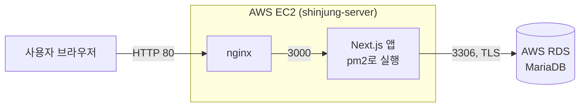
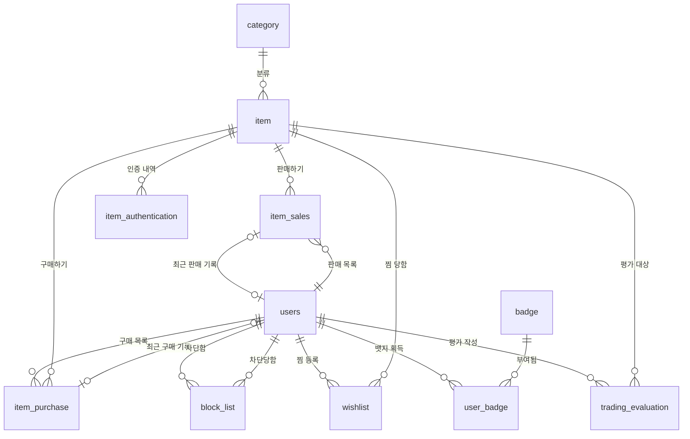

# 신중: 신뢰가는 중고거래 — 백엔드 & DB

AI 기반 중고거래 플랫폼 **신중**의 데이터베이스와 백엔드 API입니다.
지금은 **DB 테이블 11개**와 **거래 완료 API 1개**가 구현되어 있으며, AWS(EC2 + RDS)에서 동작합니다.

---

## 목차

1. [담당 기능](#1-담당-기능)
2. [기술 스택](#2-기술-스택)
3. [시스템 구조](#3-시스템-구조)
4. [폴더 구조](#4-폴더-구조)
5. [데이터베이스](#5-데이터베이스)
6. [API 명세](#6-api-명세)
7. [환경 변수](#7-환경-변수)
8. [실행 방법](#8-실행-방법)
9. [배포 (AWS)](#9-배포-aws)
10. [보안 및 주의사항](#10-보안-및-주의사항)
11. [알려진 한계와 향후 계획](#11-알려진-한계와-향후-계획)

---

## 1. 담당 기능

### 구현 완료

| 기능 | 설명 |
| --- | --- |
| DB 스키마 | 테이블 11개, 외래키 16개를 만드는 MariaDB 스크립트 (`backend/schema.sql`) |
| 거래 완료 처리 | 물품 거래가 끝나면 판매 기록·구매 기록을 만들고, 유저의 최근 판매/구매 기록을 갱신하고, 물품을 `SOLD`로 바꿈 |
| 트랜잭션 | 위 작업은 **전부 성공하거나 전부 취소**됨. 중간에 오류가 나면 이미 저장한 기록도 되돌림 |
| 이중 판매 방지 | 같은 물품에 거래 완료 요청이 동시에 와도 **한 건만** 성공 (DB 행 잠금 `SELECT ... FOR UPDATE`) |
| 입력 검사 | 잘못된 JSON, 1 이상의 정수가 아닌 ID, 판매자 = 구매자인 요청을 거절 |
| 오류 응답 | 상황별 HTTP 상태 코드와 한국어 오류 문구(`detail`)를 JSON으로 반환. DB 주소 같은 내부 정보는 응답에 담지 않음 |

### 아직 없는 기능

테이블은 모두 만들어져 있지만, 아래 기능의 API는 아직 없습니다. → [11. 향후 계획](#11-알려진-한계와-향후-계획)

회원가입·로그인 · 물품 등록/조회 · 찜 · 차단 · 뱃지 · 물품 인증 · 거래 평가 · AI 서버 연동

---

## 2. 기술 스택

| 구분 | 기술 | 버전 | 용도 |
| --- | --- | --- | --- |
| 런타임 | Node.js | 20.9 이상 (서버는 22) | JavaScript 실행 환경 |
| 프레임워크 | Next.js (App Router) | 16.4 | API(Route Handler)와 화면을 한 서버에서 제공 |
| 화면 | React | 19.2 | 거래 완료 버튼 등 화면 컴포넌트 |
| DB | MariaDB (AWS RDS) | — | 데이터 저장, 문자셋 `utf8mb4` |
| DB 드라이버 | mysql2 | 3.11 | Node.js에서 MariaDB 접속, 연결 풀·트랜잭션 |
| 서버 | AWS EC2 (Amazon Linux 2023) | t3.micro | 앱 실행 |
| 웹 서버 | nginx | — | 80번 포트로 들어온 요청을 Next.js(3000번)로 전달 |
| 프로세스 관리 | pm2 | — | 앱이 꺼지거나 서버가 재부팅되면 자동으로 다시 실행 |

---

## 3. 시스템 구조



- **지역:** 아시아 태평양(시드니) `ap-southeast-2`
- **DB 접근:** DB(RDS)는 인터넷에 열려 있지 않고, **EC2 서버에서만** 접속할 수 있습니다.
- **API 접근:** 보안 그룹에 등록된 IP에서만 접속할 수 있습니다. → [10. 보안](#10-보안-및-주의사항)

---

## 4. 폴더 구조

```
shinjung-next/
├── backend/                         백엔드 코드 전부
│   ├── schema.sql                   테이블 11개 생성 스크립트
│   ├── db.js                        DB 연결 풀, 트랜잭션 도우미(withTransaction)
│   ├── trade-service.js             거래 완료 로직 (잠금 → 검사 → 기록 생성 → 갱신)
│   └── trade-route.js               요청 검사, 응답·오류 처리
├── src/
│   ├── app/
│   │   ├── api/trades/complete/
│   │   │   └── route.js             주소 연결용 1줄 파일 (Next.js 규칙상 이 위치에 있어야 함)
│   │   ├── layout.js                화면 기본 틀
│   │   └── page.js                  연결 확인용 임시 화면
│   ├── components/
│   │   └── TradeCompleteButton.jsx  거래 완료 버튼 (중복 클릭 방지)
│   └── lib/
│       └── trade-api.js             화면에서 API를 호출하는 함수
├── .env.example                     환경 변수 예시
├── jsconfig.json                    `@/` 경로 줄임 설정
└── package.json                     필요한 패키지 목록과 실행 명령
```

| 파일 | 하는 일 |
| --- | --- |
| `db.js` | `.env.local`의 접속 정보로 연결 풀(최대 10개)을 만듭니다. `withTransaction(work)`은 `work` 안의 SQL을 하나의 트랜잭션으로 실행하고, 성공하면 저장(commit), 실패하면 취소(rollback)합니다. 개발 중 파일 저장 때마다 연결 풀이 새로 생기지 않도록 하나를 재사용합니다. |
| `trade-service.js` | 거래 완료의 실제 처리 순서를 담당합니다. 시간은 한국 시간(Asia/Seoul) 기준 초 단위로 저장합니다. |
| `trade-route.js` | 요청 JSON을 읽고 ID를 검사한 뒤 `trade-service.js`를 호출하고, 결과를 HTTP 응답으로 바꿉니다. |

---

## 5. 데이터베이스

- **DBMS:** MariaDB, 데이터베이스 이름 `shinjung`
- **문자셋:** `utf8mb4` / `utf8mb4_unicode_ci` (한글·이모지 저장 가능)
- **엔진:** InnoDB (외래키, 트랜잭션 지원)

### 테이블 목록

| # | 테이블 | 이름 | 역할 | 주요 컬럼 |
| --- | --- | --- | --- | --- |
| 1 | `category` | 카테고리 | 물품 분류 | `category_name` |
| 2 | `users` | 유저 | 회원 정보 | `nickname`(중복 불가), `region_code`, `trust_score`(기본 50), `sales_record_id`, `purchase_record_id` |
| 3 | `item` | 물품 | 판매 글 | `category_id`, `title`, `price`, `content`, `item_image`, `sales_status`, `ai_photo_verified`, `created_at` |
| 4 | `item_sales` | 물품 판매 | 판매 기록 | `seller_id`, `item_id`, `sales_date` |
| 5 | `item_purchase` | 물품 구매 | 구매 기록 | `buyer_id`, `item_id`, `purchase_date` |
| 6 | `block_list` | 차단 목록 | 유저 간 차단 | `blocker_user_id`, `blocked_user_id`, `blocked_at` |
| 7 | `item_authentication` | 물품 인증 | 정품 인증 내역 | `item_id`, `auth_type`, `serial_number`, `auth_image`, `reliability_score` |
| 8 | `wishlist` | 찜 목록 | 찜한 물품 | `user_id`, `item_id`, `wished_at` |
| 9 | `badge` | 뱃지 | 뱃지 종류 | `badge_name`, `badge_image`, `achievement_condition` |
| 10 | `user_badge` | 유저 뱃지 | 유저가 받은 뱃지 | `user_id`, `badge_id`, `achieved_at` |
| 11 | `trading_evaluation` | 거래 평가 | 거래 후 평가 | `item_id`, `user_id`, `member_type_code`, `manner_score`, `comm_score`, `time_score` |

모든 테이블의 기본키는 `BIGINT AUTO_INCREMENT`입니다. 컬럼별 자료형과 제약조건은 `backend/schema.sql`을 참고하세요.

### 관계도 (ERD)



### 순환 참조 처리

`users`와 `item_sales`, `item_purchase`는 **서로를 외래키로 참조**합니다.
아직 없는 테이블은 참조할 수 없기 때문에, `schema.sql`은 다음 순서로 만듭니다.

1. `users`를 외래키 없이 먼저 생성
2. `item_sales`, `item_purchase`를 포함한 나머지 테이블 생성
3. 맨 아래 `ALTER TABLE`로 `users.sales_record_id`, `users.purchase_record_id` 외래키 추가

### 명세에 없어 정한 값

| 항목 | 정한 값 |
| --- | --- |
| VARCHAR 길이 | 이름·코드 50, 제목·조건·시리얼 번호 200, 이미지 주소 500 |
| 판매 완료 상태값 | `SOLD` (판매 중 상태값은 아직 정하지 않음. 테스트 데이터는 `ON_SALE` 사용) |

---

## 6. API 명세

### `POST /api/trades/complete` — 거래 완료

**요청**

```json
{ "itemId": 1, "sellerId": 1, "buyerId": 2 }
```

| 필드 | 타입 | 설명 |
| --- | --- | --- |
| `itemId` | 정수 (1 이상) | 거래한 물품 ID |
| `sellerId` | 정수 (1 이상) | 판매자 유저 ID |
| `buyerId` | 정수 (1 이상) | 구매자 유저 ID |

**성공 응답 — `201 Created`**

```json
{
  "salesId": 1,
  "purchaseId": 1,
  "itemId": 1,
  "salesStatus": "SOLD",
  "completedAt": "2026-11-07T15:00:00"
}
```

`completedAt`은 한국 시간입니다.

**오류 응답** — 모두 `{ "status": 코드, "detail": "문구" }` 형식

| 코드 | 상황 | `detail` |
| --- | --- | --- |
| 400 | JSON이 아님 | 요청 내용을 읽을 수 없습니다. |
| 400 | ID가 없거나 1 이상의 정수가 아님 | itemId, sellerId, buyerId는 1 이상의 정수여야 합니다. |
| 400 | 판매자와 구매자가 같음 | 판매자와 구매자는 같을 수 없습니다. |
| 404 | 물품 없음 | 물품을 찾을 수 없습니다. |
| 404 | 판매자 없음 | 판매자를 찾을 수 없습니다. |
| 404 | 구매자 없음 | 구매자를 찾을 수 없습니다. |
| 409 | 이미 `SOLD`인 물품 | 이미 판매 완료된 물품입니다. |
| 500 | DB 오류 등 | 서버 오류로 거래 완료 처리에 실패했습니다. |

**처리 순서** (하나의 트랜잭션)

1. 물품 행을 잠그고(`FOR UPDATE`) 존재 여부와 `SOLD` 여부 확인
2. 판매자·구매자 행을 **ID가 작은 순서로** 잠금 (교착 상태 예방)
3. `item_sales`, `item_purchase`에 기록 추가
4. `users.sales_record_id`(판매자), `users.purchase_record_id`(구매자) 갱신
5. `item.sales_status`를 `SOLD`로 변경

---

## 7. 환경 변수

프로젝트 맨 위 폴더에 `.env.local` 파일을 만들어 설정합니다. (`.env.example` 참고)
**`.env.local`은 GitHub에 올리지 않습니다.**

| 이름 | 예시 | 설명 |
| --- | --- | --- |
| `DB_HOST` | `xxx.ap-southeast-2.rds.amazonaws.com` | DB 주소 (RDS 엔드포인트) |
| `DB_PORT` | `3306` | DB 포트 (기본값 3306) |
| `DB_NAME` | `shinjung` | 데이터베이스 이름 (기본값 shinjung) |
| `DB_USERNAME` | `admin` | DB 사용자 |
| `DB_PASSWORD` | — | DB 비밀번호 |
| `DB_SSL_MODE` | `verify-full` | `verify-full`: 암호화 + 인증서 검사 / `trust`: 암호화만 / `disable`: 암호화 안 함 (내 컴퓨터 DB 전용) |
| `DB_SSL_CA_FILE` | `/home/ec2-user/global-bundle.pem` | `verify-full`일 때 RDS 인증서 파일 경로 |

---

## 8. 실행 방법

### 준비물

- Node.js 20.9 이상
- MariaDB (내 컴퓨터에서 개발할 때) — RDS는 EC2 서버에서만 접속되므로, 내 컴퓨터에서는 직접 설치한 MariaDB를 씁니다.

### 내 컴퓨터에서 실행

1. 패키지 설치

   ```
   npm install
   ```

2. 테이블 만들기 (MariaDB의 root 계정 기준)

   ```
   mysql -u root -p < backend/schema.sql
   ```

3. `.env.local` 만들기 — `.env.example`을 복사한 뒤 `DB_HOST=localhost`, `DB_SSL_MODE=disable`로 바꾸고 계정·비밀번호를 채웁니다.

4. 개발 서버 실행 → 브라우저에서 `http://localhost:3000`

   ```
   npm run dev
   ```

### 테스트 데이터 넣기

물품 1, 2번과 판매자(1번)·구매자(2번) 유저를 만듭니다.

```
mysql -u root -p shinjung -e "INSERT INTO category(category_name) VALUES('가전'); INSERT INTO users(nickname,region_code) VALUES('판매자','11'),('구매자','11'); INSERT INTO item(category_id,title,price,content,sales_status,ai_photo_verified,created_at) VALUES(1,'테스트1',1000,'내용','ON_SALE',TRUE,NOW()),(1,'테스트2',2000,'내용','ON_SALE',TRUE,NOW());"
```

### API 호출 확인

첫 호출은 `201`, 같은 요청을 다시 보내면 `409`가 나오면 정상입니다.

- **Mac / Linux**

  ```
  curl -i -X POST http://localhost:3000/api/trades/complete -H 'Content-Type: application/json' -d '{"itemId":1,"sellerId":1,"buyerId":2}'
  ```

- **Windows 명령 프롬프트**

  ```
  curl -i -X POST http://localhost:3000/api/trades/complete -H "Content-Type: application/json" -d "{\"itemId\":1,\"sellerId\":1,\"buyerId\":2}"
  ```

### 실행 명령 정리

| 명령 | 하는 일 |
| --- | --- |
| `npm run dev` | 개발 서버 실행 (코드 저장 시 자동 반영) |
| `npm run build` | 배포용으로 코드 변환 |
| `npm start` | 변환된 코드로 서버 실행 (3000번 포트) |

---

## 9. 배포 (AWS)

| 항목 | 값 |
| --- | --- |
| 지역 | 아시아 태평양(시드니) `ap-southeast-2` |
| 서버 | EC2 `shinjung-server` (Amazon Linux 2023, t3.micro) |
| DB | RDS `shinjungdb1` (MariaDB) |
| 접속 주소 | 팀 내부 문서 참고 |

### 코드 반영 순서 (서버에서)

```
cd ~/shinjung-next && git pull && npm install && npm run build && pm2 restart shinjung
```

- `git pull`을 쓰려면 서버에 이 저장소를 한 번 `git clone`해 두어야 합니다. zip 업로드 방식을 쓰는 경우에는 `git pull` 대신 압축을 풉니다.
- `.env.local`은 저장소에 없으므로 서버에 따로 만들어 둡니다.
- `schema.sql`을 고친 경우, 위 명령만으로는 DB가 바뀌지 않습니다. 변경된 부분만 별도로 DB에 적용합니다.

서버 접속, 켜기·끄기, 팀원 IP 등록 방법은 팀 내부 문서 「신중 서버 참가 및 사용 설명서」를 참고하세요.

---

## 10. 보안 및 주의사항

### GitHub에 올리면 안 되는 파일

저장소 맨 위에 `.gitignore` 파일을 두고 아래 내용을 넣습니다.

```
node_modules/
.next/
.env.local
.env*.local
*.pem
shinjung_*
*.zip
```

| 파일 | 이유 |
| --- | --- |
| `.env.local` | DB 비밀번호가 들어 있음 |
| `*.pem`, `shinjung_*` | 서버 접속 열쇠 |
| `node_modules/`, `.next/` | `npm install`, `npm run build`로 다시 만들 수 있는 큰 폴더 |

이미 비밀번호나 열쇠를 올렸다면, 파일을 지우는 것만으로는 부족합니다. 커밋 기록에 남기 때문에 **비밀번호와 열쇠를 새로 바꿔야** 합니다.

### 현재 보안 상태

- **인증 없음:** 로그인 기능이 없어서 요청한 사람이 실제 판매자인지 확인하지 못합니다. 그래서 **보안 그룹에 등록된 IP에서만** 접속을 허용하고 있습니다. 로그인을 만들기 전에는 HTTP를 `0.0.0.0/0`(모든 IP)으로 열지 않습니다.
- **DB 비공개:** RDS는 인터넷에서 직접 접속할 수 없고, EC2 서버에서만 접속됩니다.
- **암호화 연결:** 서버와 DB 사이는 TLS로 암호화됩니다 (`DB_SSL_MODE`).
- **SQL 인젝션 방지:** 모든 SQL은 `?` 자리표시자로 값을 따로 전달합니다.

---

## 11. 알려진 한계와 향후 계획

### 알려진 한계

| 한계 | 설명 |
| --- | --- |
| 판매자 확인 불가 | `item` 테이블에 판매자(소유자) 컬럼이 없어, 요청의 `sellerId`가 실제 물품 주인인지 확인할 수 없습니다. |
| 최근 기록 1건만 | `users.sales_record_id`, `purchase_record_id`는 **가장 최근 기록 하나**만 가리킵니다. 전체 내역은 `item_sales`, `item_purchase`에서 조회합니다. |
| 판매 상태값 미정 | `SOLD` 외의 상태값(판매 중, 예약 중 등)이 정해지지 않았습니다. |
| 임시 화면 | `src/app/page.js`는 물품 2번을 거래하는 연결 확인용 화면입니다. |

### 향후 계획

- [ ] 회원가입·로그인 (인증) + `item`에 판매자 컬럼 추가
- [ ] 물품 등록·목록·상세 조회 API
- [ ] 찜, 차단, 뱃지 API
- [ ] 물품 인증 API + Python AI 서버 연동 (`ai_photo_verified`, `reliability_score`)
- [ ] 거래 평가 API + 신뢰점수(`trust_score`) 반영 규칙
- [ ] `sales_status` 상태값 목록 확정
- [ ] 도메인 연결과 HTTPS 적용
