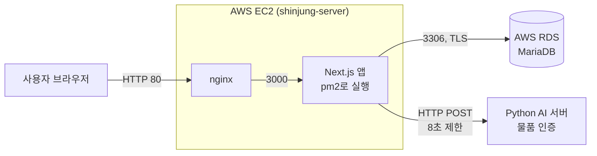
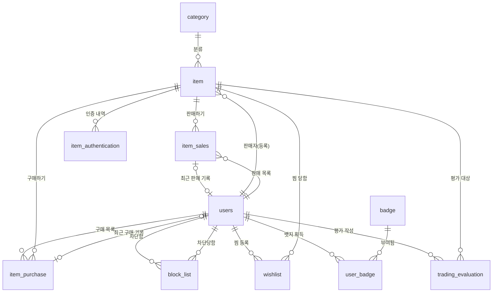

# 신중: 신뢰가는 중고거래 — 백엔드 & DB

AI 기반 중고거래 플랫폼 **신중**의 데이터베이스와 백엔드 API입니다.
DB 테이블 11개와 함께 회원가입·로그인, 물품 등록/조회, 찜, 차단, 뱃지, 거래 완료,
물품 인증(Python AI 서버 연동), 거래 평가(신뢰점수 반영)가 구현되어 있으며 AWS(EC2 + RDS)에서 동작합니다.

---

## 목차

1. [담당 기능](#1-담당-기능)
2. [기술 스택](#2-기술-스택)
3. [시스템 구조](#3-시스템-구조)
4. [폴더 구조](#4-폴더-구조)
5. [데이터베이스](#5-데이터베이스)
6. [API 명세](#6-api-명세)
7. [환경 변수](#7-환경-변수)
8. [실행 방법](#8-실행-방법)
9. [배포 (AWS)](#9-배포-aws)
10. [보안 및 주의사항](#10-보안-및-주의사항)
11. [알려진 한계와 향후 계획](#11-알려진-한계와-향후-계획)

---

## 1. 담당 기능

| 기능 | 설명 |
| --- | --- |
| DB 스키마 v2 | 테이블 11개 생성 스크립트(`backend/schema.sql`)와, 운영 중인 v1 DB를 데이터 손실 없이 올리는 마이그레이션(`backend/migration-v2.sql`) |
| 회원가입·로그인 | 닉네임 중복 검사, scrypt 비밀번호 해시, HS256 토큰을 HttpOnly 쿠키로 발급. 외부 패키지 없이 Node 내장 crypto만 사용 |
| 보호 라우트 | `requireAuth()` 헬퍼로 로그인한 사용자만 쓰기 작업 가능 |
| 카테고리 목록 | 물품 등록 화면의 선택 상자용 |
| 물품 등록/목록/상세/수정/삭제 | 등록 시 판매자 자동 지정·상태 `ON_SALE`, 목록은 카테고리·상태·판매자 필터와 **차단한 유저의 글 제외**, 상세는 카테고리·판매자(닉네임, 신뢰점수)·AI 인증 내역 포함. 수정·삭제·예약 전환은 판매자 본인만, 판매 완료 전까지 |
| 마이페이지 | 유저 프로필(신뢰점수·거래 횟수·뱃지), 유저별 등록 물품, 내 판매·구매 내역(평가 여부 포함) |
| 찜 | 토글(추가/해제)과 내 찜 목록 |
| 차단 | 차단/해제/목록, 자기 자신 차단 금지, 중복 차단 방지 |
| 뱃지 | 유저별 획득 뱃지 조회 + 조건(`TRADE_COUNT>=N`, `TRUST_SCORE>=N`)을 채우면 자동 부여하는 내부 헬퍼 |
| 거래 완료 | **로그인한 판매자 본인만.** 판매·구매 기록 생성, `users`의 최근 기록 갱신, 물품 `SOLD` 처리. 행 잠금으로 이중 판매 방지 |
| 물품 인증 (AI) | 판매자가 요청하면 Python AI 서버를 호출해 `reliability_score` 저장, `ai_photo_verified` 갱신. **8초 타임아웃**으로 AI 서버 장애가 백엔드를 멈추지 못하게 함 |
| 거래 평가 | 거래 당사자만, 완료(`SOLD`)된 거래만, 물품당 1회만 평가 가능. 상대방 신뢰점수를 공식으로 재계산(0~100)하고 조건을 채운 뱃지를 자동 부여 |

모든 처리는 트랜잭션으로 묶여 있어 **전부 성공하거나 전부 취소**됩니다.

### 아직 없는 기능

화면(UI) 전반 · 사진 업로드 · 검색 · 도메인/HTTPS 적용 · 실제 AI 모델(팀원 개발 중, 규격: `docs/AI_SERVER_SPEC.md`)

---

## 2. 기술 스택

| 구분 | 기술 | 버전 | 용도 |
| --- | --- | --- | --- |
| 런타임 | Node.js | 20.9 이상 (서버는 22) | JavaScript 실행 환경 |
| 프레임워크 | Next.js (App Router) | 16.4 | API(Route Handler)와 화면을 한 서버에서 제공 |
| 화면 | React | 19.2 | 화면 컴포넌트 |
| DB | MariaDB (AWS RDS) | — | 데이터 저장, 문자셋 `utf8mb4` |
| DB 드라이버 | mysql2 | 3.11 | Node.js에서 MariaDB 접속, 연결 풀·트랜잭션 |
| 인증 | Node 내장 `crypto` | — | scrypt 비밀번호 해시, HS256 토큰(JWT) — **추가 패키지 없음** |
| AI 연동 | 내장 `fetch` + `AbortSignal.timeout` | — | Python AI 서버 HTTP 호출과 타임아웃 |
| 서버 | AWS EC2 (Amazon Linux 2023) | t3.micro | 앱 실행 |
| 웹 서버 | nginx | — | 80번 포트 요청을 Next.js(3000번)로 전달 |
| 프로세스 관리 | pm2 | — | 앱이 꺼지거나 서버가 재부팅되면 자동 재실행 |

---

## 3. 시스템 구조



- **지역:** 아시아 태평양(시드니) `ap-southeast-2`
- **DB 접근:** RDS는 인터넷에 열려 있지 않고 EC2 서버에서만 접속할 수 있습니다.
- **API 접근:** 보안 그룹에 등록된 IP에서만 접속할 수 있습니다. → [10. 보안](#10-보안-및-주의사항)
- **AI 서버:** 주소는 환경 변수 `AI_SERVER_URL`로 지정합니다. 미지정이면 물품 인증 API만 503으로 답하고 나머지는 정상 동작합니다.

---

## 4. 폴더 구조

```
shinjung-next/
├── backend/                         백엔드 코드 전부
│   ├── schema.sql                   테이블 11개 생성 (v2, 새 DB용)
│   ├── migration-v2.sql             운영 중인 v1 DB → v2 (데이터 보존, 두 번 실행해도 안전)
│   ├── seed-badges.sql              뱃지 기본 데이터 (선택)
│   ├── constants.js                 판매 상태·평가 역할·뱃지 조건 형식 등 고정 값
│   ├── db.js                        DB 연결 풀, query(단건)·withTransaction(트랜잭션)
│   ├── http.js                      공통 오류(ApiError)·응답·입력 검사 도우미
│   ├── time.js                      한국 시간 문자열(koreaNow)
│   ├── auth-service.js / auth-route.js        회원가입·로그인·로그인 확인(requireAuth, resolveUserId)
│   ├── category-service.js / category-route.js  카테고리 목록
│   ├── item-service.js / item-route.js        물품 등록·목록·상세·수정·삭제·상태 전환
│   ├── user-service.js / user-route.js        유저 프로필·유저별 물품·내 거래 내역
│   ├── social-service.js / social-route.js    찜·차단·뱃지 (+뱃지 자동 부여 헬퍼)
│   ├── trade-service.js / trade-route.js      거래 완료
│   ├── item-auth-service.js / item-auth-route.js  물품 인증(AI 호출)
│   └── eval-service.js / eval-route.js        거래 평가·신뢰점수 계산
├── src/
│   ├── app/api/.../route.js         주소 연결용 1줄 파일들 (Next.js 규칙상 이 위치 필수)
│   ├── app/layout.js, app/page.js   화면 기본 틀, 연결 확인용 임시 화면
│   ├── components/TradeCompleteButton.jsx
│   └── lib/                         화면에서 API를 부르는 함수 모음
│       ├── auth-api.js  category-api.js  item-api.js  user-api.js
│       ├── social-api.js  item-auth-api.js  eval-api.js  trade-api.js
├── docs/AI_SERVER_SPEC.md           Python AI 서버가 맞춰야 할 요청·응답 규격
├── ai-mock/ai_mock_server.py        AI 모의 서버 (Python 3만으로 실행)
├── .env.example                     환경 변수 예시
├── jsconfig.json                    `@/` 경로 줄임 설정
└── package.json                     패키지 목록과 실행 명령
```

**역할 분리 규칙** — 새 기능은 반드시 이 4단계를 따릅니다.

1. 비즈니스 로직·SQL: `backend/<도메인>-service.js` (`db.js`의 `query`/`withTransaction` 재사용)
2. 입력 검사·HTTP 응답/오류: `backend/<도메인>-route.js`
3. Next.js 주소 연결: `src/app/api/<경로>/route.js` (backend를 다시 내보내는 1줄 파일)
4. 화면용 호출 함수: `src/lib/<도메인>-api.js`

---

## 5. 데이터베이스

- **DBMS:** MariaDB, 데이터베이스 이름 `shinjung`
- **문자셋:** `utf8mb4` / `utf8mb4_unicode_ci` (한글·이모지 저장 가능)
- **엔진:** InnoDB (외래키, 트랜잭션 지원)

### v1 → v2에서 바뀐 것

| 변경 | 이유 |
| --- | --- |
| `item.seller_id` 추가 (users 참조) | 물품의 등록자를 알 수 있어야 권한 확인이 가능 |
| `users.password_hash` 추가 | 로그인 기능 |
| UNIQUE 제약 3개 추가: 찜(유저+물품), 차단(차단자+대상), 평가(물품+작성자) | 같은 요청이 동시에 두 번 와도 중복 저장 방지 |

### 테이블 목록

| # | 테이블 | 이름 | 역할 | 주요 컬럼 |
| --- | --- | --- | --- | --- |
| 1 | `category` | 카테고리 | 물품 분류 | `category_name` |
| 2 | `users` | 유저 | 회원 정보 | `nickname`(중복 불가), `password_hash`, `region_code`, `trust_score`(기본 50), `sales_record_id`, `purchase_record_id` |
| 3 | `item` | 물품 | 판매 글 | `category_id`, `seller_id`, `title`, `price`, `content`, `item_image`, `sales_status`, `ai_photo_verified`, `created_at` |
| 4 | `item_sales` | 물품 판매 | 판매 기록 | `seller_id`, `item_id`, `sales_date` |
| 5 | `item_purchase` | 물품 구매 | 구매 기록 | `buyer_id`, `item_id`, `purchase_date` |
| 6 | `block_list` | 차단 목록 | 유저 간 차단 | `blocker_user_id`, `blocked_user_id`, `blocked_at` |
| 7 | `item_authentication` | 물품 인증 | AI 인증 내역 | `item_id`, `auth_type`, `serial_number`, `auth_image`, `reliability_score` |
| 8 | `wishlist` | 찜 목록 | 찜한 물품 | `user_id`, `item_id`, `wished_at` |
| 9 | `badge` | 뱃지 | 뱃지 종류 | `badge_name`, `badge_image`, `achievement_condition` |
| 10 | `user_badge` | 유저 뱃지 | 유저가 받은 뱃지 | `user_id`, `badge_id`, `achieved_at` |
| 11 | `trading_evaluation` | 거래 평가 | 거래 후 평가 | `item_id`, `user_id`, `member_type_code`, `manner_score`, `comm_score`, `time_score` |

모든 테이블의 기본키는 `BIGINT AUTO_INCREMENT`입니다. 컬럼별 자료형과 제약조건은 `backend/schema.sql`을 참고하세요.

### 관계도 (ERD)



### 순환 참조 처리

`users`와 `item_sales`, `item_purchase`는 서로를 외래키로 참조하므로,
`schema.sql`은 `users`를 외래키 없이 먼저 만들고 맨 아래 `ALTER TABLE`로 연결합니다.

### 명세에 없어 정한 규칙

| 항목 | 정한 값 |
| --- | --- |
| VARCHAR 길이 | 이름·코드 50, 제목·조건·시리얼 200, 이미지 주소 500, 비밀번호 해시 255 |
| 판매 상태값 | `ON_SALE`(판매 중) / `RESERVED`(예약 중) / `SOLD`(판매 완료) — `backend/constants.js` |
| 평가 점수 | `manner_score`, `comm_score`, `time_score` 각각 1~5 정수 |
| 평가 작성자 구분 | `member_type_code`는 `SELLER` 또는 `BUYER` (작성자의 역할) |
| 뱃지 자동 부여 조건 형식 | `TRADE_COUNT>=N`(판매+구매 합계) 또는 `TRUST_SCORE>=N`. 다른 문구는 자동 부여에서 제외 |
| `reliability_score` | AI가 계산한 0~100 숫자 |

### 신뢰점수 공식 (기본 50, 항상 0~100)

```
평가점수백분율 = ((매너+소통+시간)/3 - 1) / 4 * 100        ← 1~5점 평균을 0~100으로 변환
반영값        = AI 인증이 없으면 평가점수백분율
                있으면 0.8 × 평가점수백분율 + 0.2 × (그 물품 reliability_score 평균)
새 신뢰점수    = 반올림(0.7 × 기존 점수 + 0.3 × 반영값)
```

기존 점수를 70% 유지해 평가 한 번에 점수가 급격히 출렁이지 않습니다. 구현: `backend/eval-service.js`의 `computeNewTrustScore`.

---

## 6. API 명세

### 공통 규칙

- 요청·응답은 JSON입니다. 오류는 모두 `{ "status": 코드, "detail": "한국어 문구" }` 형식입니다.
- **로그인 필요** 표시가 있는 API는 로그인 때 받은 HttpOnly 쿠키(`shinjung_token`)가 있어야 하며, 없으면 `401`이 됩니다.
  브라우저의 `fetch`는 같은 서버로는 쿠키를 자동으로 보내므로 화면 코드가 따로 할 일은 없습니다.

### 전체 목록

| 메서드·주소 | 기능 | 로그인 | 성공 코드 |
| --- | --- | --- | --- |
| POST `/api/auth/signup` | 회원가입 `{nickname, password, regionCode}` (성공 시 바로 로그인 상태) | — | 201 |
| POST `/api/auth/login` | 로그인 `{nickname, password}` | — | 200 |
| POST `/api/auth/logout` | 로그아웃 (쿠키 삭제) | — | 200 |
| GET `/api/auth/me` | 지금 로그인한 사용자 | 필요 | 200 |
| GET `/api/health` | 서버 동작 확인 (DB를 쓰지 않음, 연결 점검용) | — | 200 |
| GET `/api/categories` | 카테고리 목록 | — | 200 |
| POST `/api/items` | 물품 등록 `{categoryId, title, price, content, itemImage?}` | 필요 | 201 |
| GET `/api/items?categoryId=&salesStatus=&limit=` | 물품 목록 (로그인 시 차단한 유저 글 제외) | 선택 | 200 |
| GET `/api/items/{itemId}` | 물품 상세 (판매자·카테고리·AI 인증 내역 포함) | — | 200 |
| PUT `/api/items/{itemId}` | 물품 수정 — 바꿀 항목만 `{title?, price?, content?, categoryId?, itemImage?}` | 필요(판매자 본인) | 200 |
| PATCH `/api/items/{itemId}/status` | 판매 상태 전환 `{salesStatus: "ON_SALE" \| "RESERVED"}` | 필요(판매자 본인) | 200 |
| DELETE `/api/items/{itemId}` | 물품 삭제 (판매 완료 전까지, 찜·인증 기록도 함께 삭제) | 필요(판매자 본인) | 200 |
| POST `/api/items/{itemId}/authenticate` | 물품 인증 `{authType, serialNumber?, authImage?}` — AI 호출 | 필요(판매자 본인) | 201 |
| POST `/api/wishlist` | 찜 토글 `{itemId}` → `{wished: true/false}` | 필요 | 200 |
| GET `/api/wishlist` | 내 찜 목록 | 필요 | 200 |
| POST `/api/blocks` | 유저 차단 `{targetUserId}` | 필요 | 201 |
| DELETE `/api/blocks/{userId}` | 차단 해제 | 필요 | 200 |
| GET `/api/blocks` | 내가 차단한 유저 목록 | 필요 | 200 |
| GET `/api/users/{userId}` | 유저 프로필 (닉네임, 지역, 신뢰점수, 등록 물품 수, 거래 횟수, 뱃지) | — | 200 |
| GET `/api/users/{userId}/items?salesStatus=&limit=` | 그 유저가 등록한 물품 목록 | — | 200 |
| GET `/api/users/{userId}/trades` | 판매·구매 내역 `{sales, purchases}` (각 항목에 `evaluated` 포함) | 필요(본인만) | 200 |
| GET `/api/users/{userId}/badges` | 유저가 받은 뱃지 목록 | — | 200 |
| POST `/api/trades/complete` | 거래 완료 `{itemId, buyerId}` — 판매자는 로그인 사용자로 자동 판별 | 필요(판매자 본인) | 201 |
| POST `/api/evaluations` | 거래 평가 `{itemId, memberTypeCode, mannerScore, commScore, timeScore}` | 필요(거래 당사자) | 201 |

`/api/users/{userId}...` 주소의 `{userId}` 자리에 **`me`**를 넣으면 로그인한 본인을 뜻합니다. (예: `/api/users/me/items` = 내 물품)

### 예시 1: 거래 평가

요청 (구매자가 판매자를 평가):

```json
{ "itemId": 1, "memberTypeCode": "BUYER", "mannerScore": 5, "commScore": 4, "timeScore": 5 }
```

성공 `201`:

```json
{ "evalId": 1, "itemId": 1, "targetUserId": 1, "newTrustScore": 62,
  "grantedBadges": [ { "badgeId": 1, "badgeName": "첫 거래" } ] }
```

주요 오류: `409` 판매 완료 아님/이미 평가함, `403` 거래 당사자 아님, `400` 점수 범위 밖.

### 예시 2: 물품 인증 (AI)

요청: `POST /api/items/3/authenticate`

```json
{ "authType": "정품 영수증", "serialNumber": "SN-12345", "authImage": "https://.../auth.jpg" }
```

성공 `201`:

```json
{ "authId": 1, "itemId": 3, "photoVerified": true, "reliabilityScore": 87.5 }
```

주요 오류: `403` 판매자 아님, `502` AI 서버 무응답·형식 오류(이때 DB에는 아무것도 저장되지 않음), `503` `AI_SERVER_URL` 미설정.
AI 서버 규격과 모의 서버 사용법: `docs/AI_SERVER_SPEC.md`

---

## 7. 환경 변수

프로젝트 맨 위 폴더의 `.env.local`에 설정합니다. (`.env.example` 참고, **GitHub에 올리지 않음**)

| 이름 | 예시 | 설명 |
| --- | --- | --- |
| `DB_HOST` | `xxx.ap-southeast-2.rds.amazonaws.com` | DB 주소 (RDS 엔드포인트) |
| `DB_PORT` | `3306` | DB 포트 (기본 3306) |
| `DB_NAME` | `shinjung` | 데이터베이스 이름 (기본 shinjung) |
| `DB_USERNAME` | `admin` | DB 사용자 |
| `DB_PASSWORD` | — | DB 비밀번호 |
| `DB_SSL_MODE` | `trust` | `verify-full`(암호화+인증서 검사) / `trust`(암호화만) / `disable` |
| `DB_SSL_CA_FILE` | `/home/ec2-user/global-bundle.pem` | `verify-full`일 때 RDS 인증서 경로 |
| `SESSION_SECRET` | 32자 이상 임의 문자열 | **(신규)** 로그인 토큰 서명 키. 없으면 로그인 API가 500으로 알려줌. 생성: `openssl rand -base64 32` |
| `COOKIE_SECURE` | `true` | **(신규, 선택)** HTTPS 적용 후에만 켜기. 쿠키를 HTTPS 전용으로 만듦 |
| `AI_SERVER_URL` | `http://127.0.0.1:8600/verify` | **(신규, 선택)** Python AI 서버 주소. 없으면 물품 인증만 503 |
| `AI_SERVER_TIMEOUT_MS` | `8000` | **(신규, 선택)** AI 응답 대기 한도(밀리초, 기본 8000) |

---

## 8. 실행 방법

### 준비물

- Node.js 20.9 이상, (내 컴퓨터 개발 시) MariaDB
- 추가 npm 패키지 없음 — 의존성은 v1과 동일 (`next`, `react`, `react-dom`, `mysql2`)

### 내 컴퓨터에서 실행

1. 패키지 설치: `npm install`
2. 테이블 만들기 (새 DB): `mysql -u root -p < backend/schema.sql`
   - 이미 v1 테이블이 있다면 대신: `mysql -u root -p < backend/migration-v2.sql`
3. (선택) 뱃지 기본 데이터: `mysql -u root -p < backend/seed-badges.sql`
4. `.env.local` 작성 — `.env.example` 복사 후 `DB_HOST=localhost`, `DB_SSL_MODE=disable`, `SESSION_SECRET` 입력
5. (선택) AI 모의 서버: `python3 ai-mock/ai_mock_server.py` 실행 후 `.env.local`에 `AI_SERVER_URL=http://127.0.0.1:8600/verify`
6. 실행: `npm run dev` → `http://localhost:3000`

### 기본 데이터와 사용 흐름

v2부터 유저는 반드시 **회원가입 API로** 만듭니다(비밀번호 해시 때문). 카테고리만 SQL로 넣으면 됩니다.

```
mysql -u root -p shinjung -e "INSERT INTO category(category_name) VALUES('가전');"
```

흐름: 회원가입 → 로그인(쿠키 발급) → 물품 등록 → (선택) 물품 인증 → 거래 완료 → 거래 평가 → 신뢰점수·뱃지 반영

### curl로 확인 (Mac/Linux 기준, Windows는 작은따옴표 대신 큰따옴표+`\"`)

```
curl -i -c cookies.txt -X POST http://localhost:3000/api/auth/signup -H 'Content-Type: application/json' -d '{"nickname":"테스터","password":"pass12345","regionCode":"11"}'
curl -i -b cookies.txt -X POST http://localhost:3000/api/items -H 'Content-Type: application/json' -d '{"categoryId":1,"title":"노트북","price":500000,"content":"상태 좋아요"}'
curl -s http://localhost:3000/api/items
```

`-c cookies.txt`는 받은 쿠키를 파일에 저장하고, `-b cookies.txt`는 그 쿠키를 붙여 보냅니다(로그인 상태 재현).

### 실행 명령 정리

| 명령 | 하는 일 |
| --- | --- |
| `npm run dev` | 개발 서버 (코드 저장 시 자동 반영) |
| `npm run build` | 배포용 변환 |
| `npm start` | 변환된 코드로 실행 (3000번 포트) |

---

## 9. 배포 (AWS)

| 항목 | 값 |
| --- | --- |
| 지역 | 아시아 태평양(시드니) `ap-southeast-2` |
| 서버 | EC2 `shinjung-server` (Amazon Linux 2023, t3.micro) |
| DB | RDS `shinjungdb1` (MariaDB) |
| 접속 주소 | 팀 내부 문서 참고 |

### 이번 버전(v2)을 처음 반영할 때 — 순서 중요

```
# 1) 운영 DB 구조 올리기 (기존 데이터 보존, 두 번 실행해도 안전)
mysql -h <RDS주소> -u admin -p --ssl-ca=$HOME/global-bundle.pem --ssl-verify-server-cert < backend/migration-v2.sql
# 2) (선택) 뱃지 기본 데이터 — 한 번만
mysql -h <RDS주소> -u admin -p --ssl-ca=$HOME/global-bundle.pem --ssl-verify-server-cert < backend/seed-badges.sql
# 3) 토큰 서명 키 추가 — 한 번만
printf 'SESSION_SECRET=%s\n' "$(openssl rand -base64 32)" >> .env.local
# 4) 빌드·재시작
npm install && npm run build && pm2 restart shinjung
```

마이그레이션 후 기존 테스트 유저('판매자', '구매자')는 로그인할 수 없는 표시(`!`)가 되고,
기존 물품의 판매자는 1번 유저로 채워집니다. 실제 사용은 새로 가입해서 하세요.

### 평소 코드 반영

```
cd ~/shinjung-next && git pull && npm install && npm run build && pm2 restart shinjung
```

(zip 업로드 방식이면 `git pull` 대신 `unzip -o`. `.env.local`은 저장소·zip에 없으므로 유지됩니다.)
`schema.sql`을 고친 경우 위 명령만으로 DB는 바뀌지 않습니다. 변경분을 마이그레이션 SQL로 따로 적용하세요.

서버 접속, 켜기·끄기, 팀원 IP 등록은 팀 내부 문서 「신중 서버 참가 및 사용 설명서」 참고.

---

## 10. 보안 및 주의사항

### GitHub에 올리면 안 되는 파일 (.gitignore)

```
node_modules/
.next/
.env.local
.env*.local
*.pem
shinjung_*
*.zip
cookies.txt
```

비밀번호나 열쇠를 이미 올렸다면 파일 삭제로는 부족합니다(커밋 기록에 남음). **값 자체를 새로 바꾸세요.**

### 현재 보안 상태

- **비밀번호:** scrypt 해시로만 저장. 원문은 어디에도 저장하지 않음
- **로그인 토큰:** HS256 서명 + HttpOnly 쿠키(스크립트 탈취 방지), 7일 만료
- **SQL 인젝션 방지:** 모든 SQL은 `?` 자리표시자로 값을 분리
- **DB 비공개:** RDS는 EC2에서만 접속 가능, 서버-DB 간 TLS 암호화
- **오류 응답:** 내부 정보(DB 주소 등)는 응답에 담지 않고 서버 로그에만 기록
- **쓰기 작업은 모두 로그인 필수:** 물품 등록·수정·삭제, 거래 완료, 찜, 차단, 평가, 물품 인증은 로그인한 본인(또는 거래 당사자)만 할 수 있습니다. 로그인 기능이 있지만 화면(UI)이 아직 없으므로, 공개 범위를 넓히는 것은 화면과 HTTPS를 갖춘 뒤에 하세요.

---

## 11. 알려진 한계와 향후 계획

### 알려진 한계

| 한계 | 설명 |
| --- | --- |
| 최근 기록 1건만 | `users.sales_record_id`/`purchase_record_id`는 가장 최근 기록 하나만 가리킴. 전체 내역은 `item_sales`/`item_purchase` 조회 |
| 이미지 업로드 없음 | `item_image`, `auth_image`는 이미 올라가 있는 이미지의 주소(문자열)만 저장 |
| 임시 화면 | `src/app/page.js`는 연결 확인용 |

### 향후 계획

- [x] 회원가입·로그인 + `item` 판매자 컬럼
- [x] 물품 등록·목록·상세 API
- [x] 찜, 차단, 뱃지 API
- [x] 물품 인증 API + AI 서버 연동 규격(`ai_photo_verified`, `reliability_score`)
- [x] 거래 평가 API + 신뢰점수(`trust_score`) 반영 + 뱃지 자동 부여
- [x] `sales_status` 상태값 확정 (`backend/constants.js`)
- [x] 거래 완료 API 로그인 보호 전환
- [x] 카테고리 목록, 물품 수정·삭제, 예약(`RESERVED`) 전환 API
- [x] 마이페이지 API (프로필, 유저별 물품, 내 거래 내역)
- [ ] 이미지 업로드 (S3 등)
- [ ] 검색 (제목)
- [ ] 실제 Python AI 모델 서버 (팀원, `docs/AI_SERVER_SPEC.md` 규격)
- [ ] 도메인 연결과 HTTPS 적용
- [ ] 화면(UI) 개발
